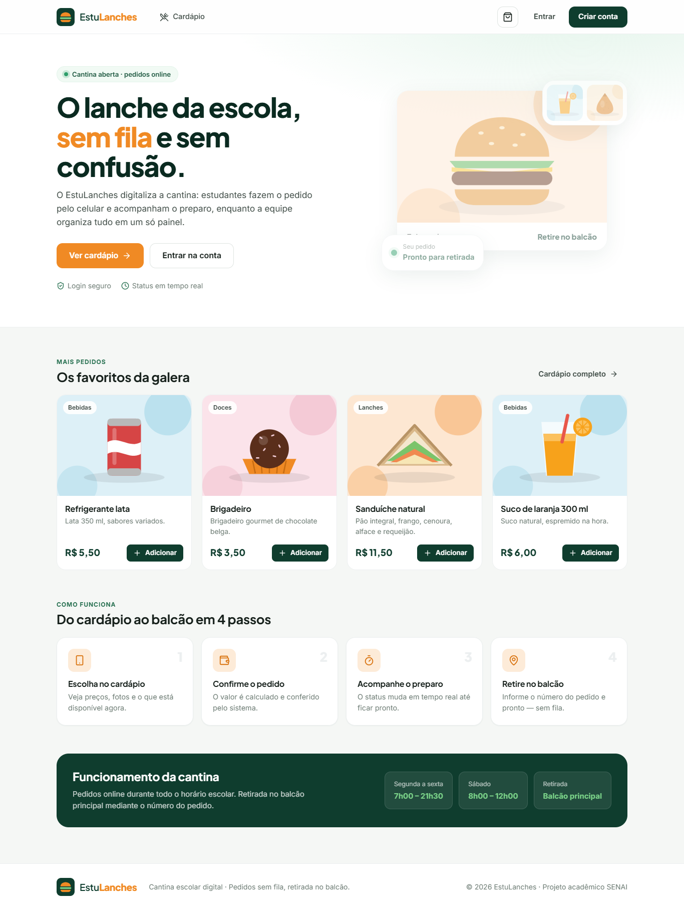
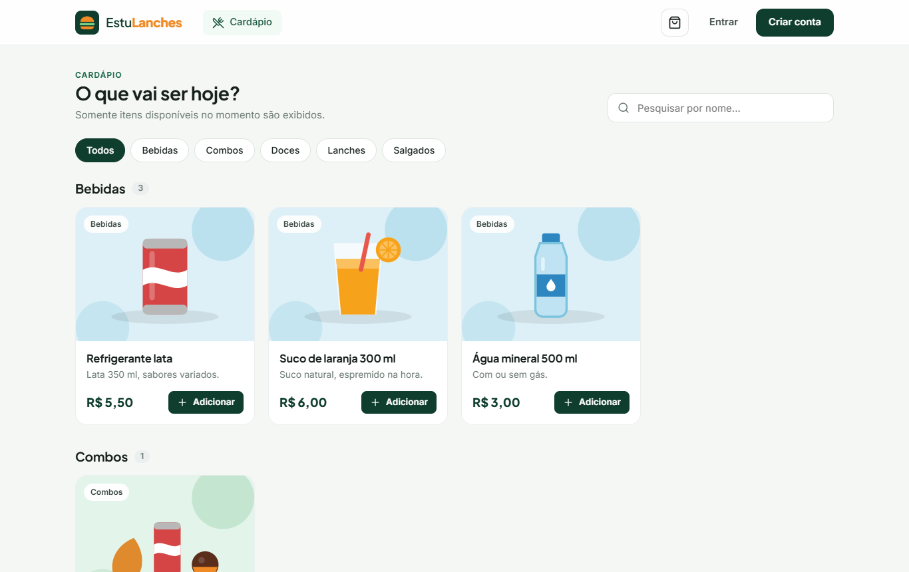
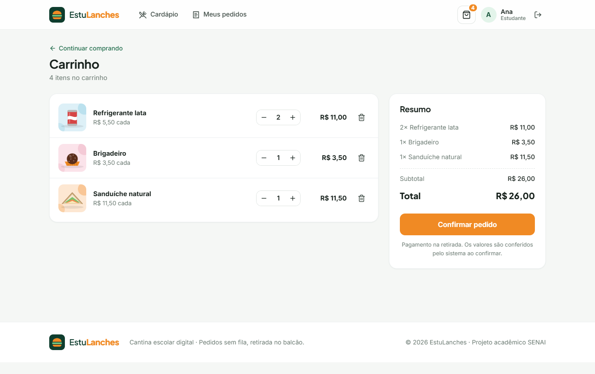
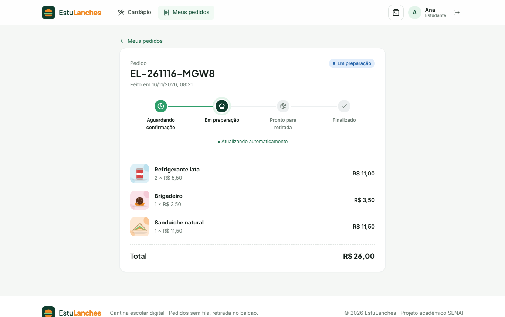
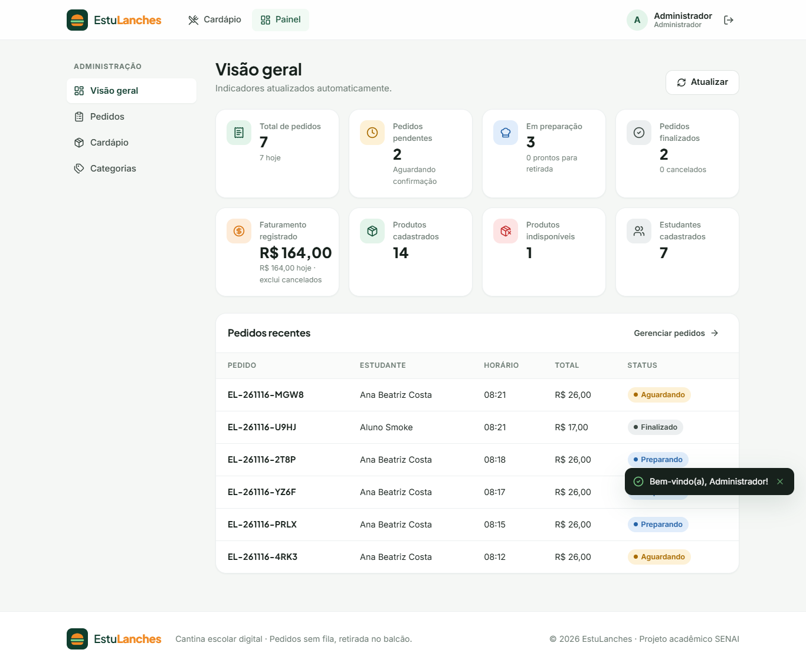
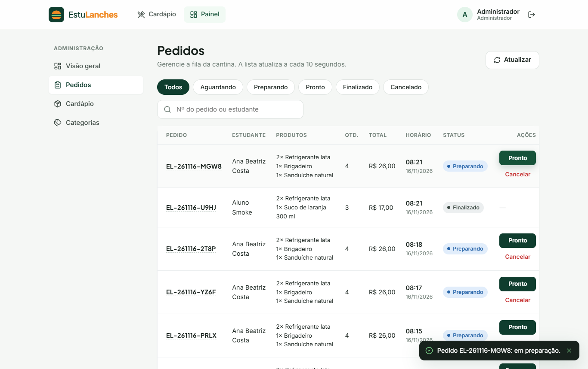
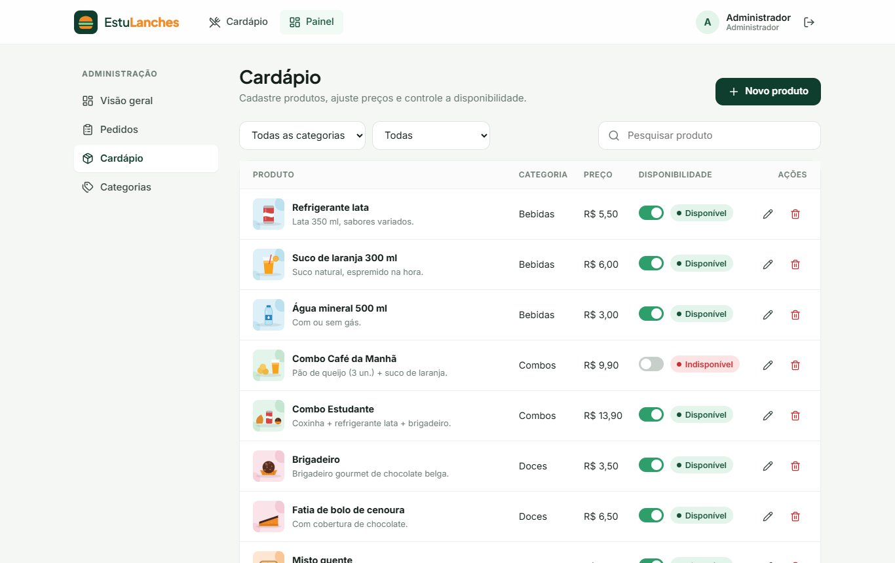
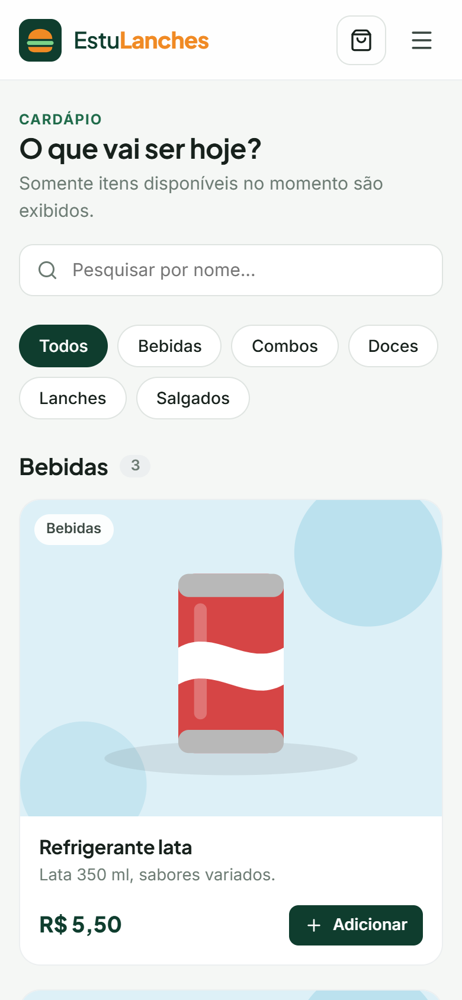

<div align="center">


# EstuLanches

**Sistema de gestão de cantina escolar** — cardápio digital, pedidos online com acompanhamento em tempo real e painel administrativo.

React · Node.js · Express · Prisma 7.8.0 · PostgreSQL · Docker

</div>

---

## Sumário

- [Sobre o projeto](#sobre-o-projeto)
- [Funcionalidades](#funcionalidades)
- [Screenshots](#screenshots)
- [Tecnologias](#tecnologias)
- [Arquitetura](#arquitetura)
- [Estrutura de pastas](#estrutura-de-pastas)
- [Pré-requisitos](#pré-requisitos)
- [Configuração do ambiente](#configuração-do-ambiente)
- [Executando com Docker](#executando-com-docker)
- [Verificando containers e logs](#verificando-containers-e-logs)
- [Acessando a aplicação](#acessando-a-aplicação)
- [Testes automatizados](#testes-automatizados)
- [Migrations](#migrations)
- [Desenvolvimento local (sem Docker)](#desenvolvimento-local-sem-docker)
- [API REST](#api-rest)
- [Segurança](#segurança)
- [Decisões técnicas](#decisões-técnicas)
- [Escalabilidade](#escalabilidade)
- [Documentação complementar](#documentação-complementar)

---

## Sobre o projeto

Projeto desenvolvido para a Situação de Aprendizagem do curso **Técnico em Desenvolvimento de Sistemas — SENAI**.

### O problema

Cantinas escolares costumam funcionar com processos manuais: pedidos anotados em papel, preços consultados de cabeça, filas longas no intervalo e erros de comunicação entre o balcão e a cozinha. Não há controle centralizado do que foi vendido nem de quais produtos estão disponíveis.

### A solução

O **EstuLanches** digitaliza esse fluxo:

- o **estudante** consulta o cardápio pelo celular, monta o carrinho, confirma o pedido e acompanha o preparo até a retirada;
- a **equipe da cantina** recebe os pedidos em uma fila organizada, atualiza o status de cada um e administra produtos, preços, categorias e disponibilidade;
- a **administração** visualiza indicadores (pedidos, faturamento, produtos indisponíveis) em um painel.

---

## Funcionalidades

**Página inicial:** apresentação da plataforma, produtos mais pedidos (calculados a partir dos pedidos reais), passo a passo de uso e horário de funcionamento.

**Autenticação (JWT):**
- cadastro de estudantes, login, logout e recuperação de sessão (o token salvo é revalidado em `/api/auth/me`);
- proteção de rotas no frontend e no backend; perfis `STUDENT` e `ADMIN`;
- senhas com hash **bcrypt**; validação de dados no cliente e no servidor.

**Cardápio:** produtos agrupados por categoria, com imagem, descrição, preço e disponibilidade; filtro por categoria e pesquisa por nome.

**Carrinho e pedidos:**
- adicionar, remover e alterar quantidades (1 a 20 por item), subtotal e total;
- ao confirmar, o **backend** busca preço e disponibilidade no banco, recalcula o total e grava o pedido em uma **transação**;
- número identificador legível (ex.: `EL-261116-7KQ2`);
- acompanhamento em tempo real (atualização automática a cada 8–10 s) pelos estados **Aguardando confirmação → Em preparação → Pronto para retirada → Finalizado** (ou **Cancelado**);
- o estudante pode cancelar o próprio pedido enquanto ele aguarda confirmação.

**Painel administrativo:**
- indicadores: total de pedidos, pendentes, em preparação, finalizados, faturamento registrado (exclui cancelados), produtos cadastrados e indisponíveis;
- tabela de pedidos com número, estudante, produtos, quantidade, total, horário, status e ações (respeitando a máquina de estados); filtro por status, busca e paginação;
- CRUD de produtos (com ativar/desativar) e de categorias.

---

## Screenshots

| Página inicial | Cardápio |
| --- | --- |
|  |  |

| Carrinho | Acompanhamento do pedido |
| --- | --- |
|  |  |

| Painel administrativo | Gestão de pedidos |
| --- | --- |
|  |  |

| Gestão do cardápio | Mobile |
| --- | --- |
|  |  |

Todas as capturas estão em [docs/screenshots/](docs/screenshots/). Elas foram geradas navegando na aplicação real em execução nos containers.

---

## Tecnologias

| Camada | Tecnologias |
| --- | --- |
| Frontend | React 19, Vite 7, React Router 7, Axios, lucide-react (ícones), CSS por componente |
| Backend | Node.js 24, Express 5, TypeScript, Zod (validação), jsonwebtoken (JWT), bcrypt, cors, helmet, express-rate-limit, dotenv, Nodemon (dev) |
| Banco de dados | PostgreSQL 17, **Prisma ORM 7.8.0** com driver adapter `@prisma/adapter-pg` e migrations |
| Testes | Vitest 4 + Supertest |
| Infraestrutura | Docker (Dockerfile multi-stage), Docker Compose, volume persistente, rede interna, healthchecks |

---

## Arquitetura

```
                ┌──────────────────────── Docker Compose ─────────────────────────┐
                │                                                                 │
 Navegador ───► │  app (estulanches-app)                     db (estulanches-db)  │
 :3000          │  ┌───────────────────────────────┐        ┌──────────────────┐  │
                │  │ Express                        │  rede  │ PostgreSQL 17    │  │
                │  │  ├─ /            → React (SPA) │ ─────► │ banco estulanches│  │
                │  │  └─ /api/*       → API REST    │ interna│ volume pgdata    │  │
                │  │       Prisma 7 + adapter-pg    │ db:5432│                  │  │
                │  └───────────────────────────────┘        └──────────────────┘  │
                └─────────────────────────────────────────────────────────────────┘
```

- **Um container de aplicação** serve o build do React e a API na mesma origem (sem problemas de CORS em produção e uma porta só).
- **Backend em camadas:** `routes → middlewares (auth, validação) → controllers → services (regras de negócio) → Prisma`.
- O backend acessa o banco pelo **nome do serviço** (`db:5432`), nunca por `localhost`.
- O banco **não publica porta** no host: só é acessível pela rede interna `estulanches-net`.

Detalhes em [docs/ARQUITETURA.md](docs/ARQUITETURA.md).

---

## Estrutura de pastas

```
estulanches/
├── backend/
│   ├── prisma/
│   │   ├── schema.prisma          # modelagem (User, Category, Product, Order, OrderItem)
│   │   └── migrations/            # histórico versionado do banco
│   ├── prisma.config.ts           # configuração do Prisma 7 (URL, migrations, seed)
│   ├── src/
│   │   ├── config/                # env.ts (variáveis), prisma.ts (client + adapter)
│   │   ├── controllers/           # camada HTTP
│   │   ├── middlewares/           # auth (JWT + perfil), validate (Zod), errorHandler
│   │   ├── routes/                # definição das rotas /api
│   │   ├── schemas/               # schemas de validação (Zod)
│   │   ├── services/              # regras de negócio e acesso a dados
│   │   ├── utils/                 # jwt, password, cart, orderStatus, validators...
│   │   ├── scripts/seed.ts        # seed idempotente (categorias, cardápio, admin)
│   │   ├── tests/unit/            # testes unitários
│   │   ├── tests/integration/     # testes de integração (API + banco de teste)
│   │   ├── app.ts                 # montagem do Express
│   │   └── server.ts              # inicialização e encerramento gracioso
│   ├── vitest.config.ts
│   └── package.json
├── frontend/
│   ├── public/images/products/    # ilustrações dos produtos (SVG)
│   ├── src/
│   │   ├── components/            # Navbar, ProductCard, Modal, StatusBadge... (+ .css)
│   │   ├── hooks/                 # useAuth, useCart, useToast, useFetch
│   │   ├── pages/                 # Home, Menu, Cart, Orders, Auth, admin/*
│   │   ├── services/              # cliente Axios e chamadas à API
│   │   ├── styles/                # tokens de design e estilos globais
│   │   └── utils/                 # formatação e regras de status
│   └── package.json
├── docker/entrypoint.sh           # migrations → seed → servidor
├── docs/
│   ├── RDM.pdf                    # Ficha de Registro de Mudança
│   ├── ARQUITETURA.md
│   ├── ESCALABILIDADE.md
│   ├── IMPLANTACAO.md
│   ├── ROTEIRO_VIDEO.md
│   ├── evidencias/                # saídas reais da implantação e dos testes
│   ├── rdm/                       # fonte (HTML) e gerador do RDM.pdf
│   └── screenshots/
├── Dockerfile
├── docker-compose.yml
├── .dockerignore
├── .gitignore
├── .env.example
└── README.md
```

---

## Pré-requisitos

- [Docker Desktop](https://www.docker.com/products/docker-desktop/) (Docker Engine 24+ e Docker Compose v2)
- Para rodar testes ou desenvolver sem Docker: **Node.js 20.19+, 22.12+ ou 24+** (exigência do Prisma 7)

---

## Configuração do ambiente

```bash
git clone <url-do-repositorio> estulanches
cd estulanches
cp .env.example .env
```

Edite o `.env`. Para o ambiente acadêmico, use o usuário `senai` e a senha definida para a atividade:

```dotenv
POSTGRES_USER=senai
POSTGRES_PASSWORD=<senha do banco>
POSTGRES_DB=estulanches
JWT_SECRET=<gere um segredo forte, veja abaixo>
ADMIN_EMAIL=admin@estulanches.com
ADMIN_PASSWORD=<senha do administrador inicial>
```

Gere o segredo do JWT com:

```bash
node -e "console.log(require('crypto').randomBytes(48).toString('hex'))"
```

> O `.env` está no `.gitignore` e **nunca** deve ser versionado. A senha do banco existe apenas nesse arquivo; o `docker-compose.yml` só referencia variáveis (`${POSTGRES_PASSWORD}`).

---

## Executando com Docker

```bash
# construir as imagens e iniciar em segundo plano
docker compose up -d --build

# encerrar (mantém os dados do banco)
docker compose down
```

Na inicialização, o container `app` aguarda o healthcheck do banco (`pg_isready`), aplica as migrations (`prisma migrate deploy`), executa o seed idempotente e só então inicia o servidor com `node` (sem Nodemon).

> ⚠️ **Não use `docker compose down -v` em operações normais.** A opção `-v` apaga o volume `estulanches_pgdata` e todos os dados do banco.

---

## Verificando containers e logs

```bash
docker compose ps                 # estado e saúde (healthy) dos containers
docker compose logs               # logs de todos os serviços
docker compose logs app           # logs da aplicação
docker compose logs db            # logs do PostgreSQL
docker compose logs -f app        # acompanhar em tempo real
docker compose port app 3000      # porta publicada no host
```

Saída esperada do `docker compose ps`:

```
NAME              IMAGE                   SERVICE   STATUS                    PORTS
estulanches-app   estulanches-app:1.0.0   app       Up 18 seconds (healthy)   0.0.0.0:3000->3000/tcp
estulanches-db    postgres:17-alpine      db        Up 24 seconds (healthy)   5432/tcp
```

Para diagnóstico de erros de inicialização e portas ocupadas, veja [docs/IMPLANTACAO.md](docs/IMPLANTACAO.md).

---

## Acessando a aplicação

| Recurso | Endereço |
| --- | --- |
| Aplicação web | http://localhost:3000 |
| Healthcheck da API | http://localhost:3000/api/health |

- **Administrador:** e-mail e senha definidos em `ADMIN_EMAIL` / `ADMIN_PASSWORD` no `.env` (criado automaticamente na primeira inicialização).
- **Estudante:** crie uma conta em **Criar conta**.

---

## Testes automatizados

Os testes usam **Vitest** + **Supertest** e um **banco de teste separado** (`estulanches_test`, container `db-test`, dados em memória). Uma trava de segurança impede a suíte de rodar se a `DATABASE_URL` não apontar para um banco de teste.

```bash
# 1. subir o banco de testes (porta 5433, apenas localhost)
docker compose --profile test up -d db-test

# 2. preparar o backend
cd backend
npm install
cp .env.test.example .env.test     # ajuste usuário/senha

# 3. executar
npm run test:unit           # 49 testes unitários
npm run test:integration    # 30 testes de integração
npm test                    # todos
```

| Suíte | Cobertura | Resultado (16/11/2026) |
| --- | --- | --- |
| Unitários | validação de e-mail, hash e comparação bcrypt, geração/validação/expiração de JWT, cálculo do carrinho em centavos, quantidade, máquina de status, número do pedido | **49/49 aprovados** |
| Integração | cadastro, login válido/inválido, rota protegida sem token, acesso admin negado (403), consulta de produtos, criação de pedido (preço do banco, snapshot de preço, indisponível, inexistente), pedidos do usuário, atualização de status, dados inválidos (400) | **30/30 aprovados** |

As saídas completas estão em [docs/evidencias/](docs/evidencias/).

---

## Migrations

```bash
cd backend

# criar uma nova migration após alterar prisma/schema.prisma (desenvolvimento)
npx prisma migrate dev --name descricao_da_mudanca

# aplicar migrations pendentes (produção — feito automaticamente pelo container)
npx prisma migrate deploy

# aplicar manualmente dentro do container em execução
docker compose exec app ./node_modules/.bin/prisma migrate deploy

# verificar o estado das migrations
docker compose exec app ./node_modules/.bin/prisma migrate status
```

---

## Desenvolvimento local (sem Docker)

```bash
docker compose --profile test up -d db-test      # um PostgreSQL local na porta 5433

cd backend
npm install
cp .env.example .env                              # ajuste DATABASE_URL e JWT_SECRET
npx prisma migrate deploy
npm run seed
npm run dev                                       # nodemon + tsx em http://localhost:3000

cd ../frontend
npm install
npm run dev                                       # Vite em http://localhost:5173 (proxy /api → :3000)
```

---

## API REST

| Método | Rota | Acesso | Descrição |
| --- | --- | --- | --- |
| GET | `/api/health` | público | saúde da API e do banco |
| POST | `/api/auth/register` | público | cadastro (sempre perfil estudante) |
| POST | `/api/auth/login` | público | login, retorna JWT |
| GET | `/api/auth/me` | autenticado | recuperação de sessão |
| POST | `/api/auth/logout` | autenticado | logout |
| GET | `/api/categories` | público | lista categorias |
| GET | `/api/products?search=&categoryId=` | público | cardápio (somente disponíveis) |
| GET | `/api/products/popular` | público | mais pedidos |
| GET | `/api/products/:id` | público | detalhe do produto |
| POST | `/api/orders` | estudante | cria pedido `{ items: [{ productId, quantity }] }` |
| GET | `/api/orders/my` | autenticado | pedidos do usuário |
| GET | `/api/orders/:id` | dono ou admin | detalhe do pedido |
| PATCH | `/api/orders/:id/cancel` | estudante (dono) | cancela pedido pendente |
| GET | `/api/admin/dashboard` | admin | indicadores |
| GET | `/api/admin/orders?status=&search=&page=` | admin | pedidos (paginado) |
| PATCH | `/api/admin/orders/:id/status` | admin | atualiza status |
| GET/POST | `/api/admin/products` | admin | lista (inclui indisponíveis) / cria |
| PUT/DELETE | `/api/admin/products/:id` | admin | edita / exclui |
| POST | `/api/admin/categories` | admin | cria categoria |
| PUT/DELETE | `/api/admin/categories/:id` | admin | edita / exclui |

Erros seguem o formato `{ "error": "mensagem", "details": [...] }` com status HTTP adequado (400, 401, 403, 404, 409, 500).

---

## Segurança

| Medida | Implementação |
| --- | --- |
| Senhas | hash **bcrypt** (salt automático, custo configurável); nunca retornadas pela API |
| Autenticação | **JWT** HS256 com emissor e expiração (8 h); segredo de 32+ caracteres obrigatório em produção |
| Autorização | middlewares `authenticate` + `authorize("ADMIN")`; o perfil é relido do banco a cada requisição |
| Escalada de privilégio | o cadastro público ignora o campo `role` (sempre `STUDENT`) |
| Acesso a dados de terceiros | pedido de outro usuário retorna 404 (não revela existência) |
| Validação | Zod em body, query e params; regras de negócio no backend (preço e disponibilidade vêm do banco) |
| Injeção SQL | consultas via Prisma (parametrizadas) |
| CORS | somente origens de `CORS_ORIGINS` |
| Cabeçalhos HTTP | `helmet` (CSP, HSTS, X-Frame-Options...), `x-powered-by` desativado |
| Força bruta | rate limit de 20 tentativas / 15 min em login e cadastro; resposta de login idêntica para e-mail inexistente ou senha errada |
| Erros | tratamento centralizado; stack traces nunca enviados ao cliente |
| Segredos | somente em variáveis de ambiente (`.env` fora do Git; `.env.example` sem credenciais reais) |
| Containers | processo executado como usuário **não-root** (`node`); banco sem porta publicada no host |
| Concorrência | criação de pedido em transação `Serializable`; mudança de status condicional ao status atual |

---

## Decisões técnicas

- **Prisma 7.8.0:** o Prisma 7 trouxe mudanças importantes em relação a versões antigas. Seguimos o padrão atual:
  - generator `prisma-client`, com o client gerado em `src/generated/prisma`;
  - URL de conexão em `prisma.config.ts` (e não mais no `schema.prisma`);
  - conexão em tempo de execução via driver adapter `@prisma/adapter-pg`;
  - opção `importFileExtension = "js"` para compilar com `tsc` em ESM.
- **Backend em TypeScript:** tipos gerados pelo Prisma evitam erros de modelagem; o build gera JavaScript puro (`dist/`) executado com `node`.
- **Dinheiro em centavos:** totais calculados com inteiros para evitar erros de ponto flutuante; no banco, `Decimal(10,2)`.
- **Snapshot de preço:** `OrderItem.unitPrice` guarda o preço da compra; reajustes não alteram pedidos antigos (coberto por teste).
- **Exclusão segura:** produtos que já foram pedidos não podem ser excluídos (preserva o histórico), apenas desativados. Categorias com produtos também não.
- **Um container para frontend + API:** simplifica a implantação acadêmica e elimina CORS em produção. Na evolução, o frontend pode ir para uma CDN (ver escalabilidade).
- **Tempo real por polling:** atualização a cada 8–10 s, simples e robusta para o volume de uma cantina. WebSocket/SSE é uma evolução natural.
- **Seed idempotente no entrypoint:** permite `docker compose up` em uma máquina nova sem passos manuais, sem duplicar dados nas reinicializações.
- **Imagens dos produtos:** ilustrações SVG próprias (leves e sem problemas de direitos autorais). O administrador pode informar qualquer URL de imagem.

---

## Escalabilidade

A versão atual é uma aplicação acadêmica pensada para **uma cantina**, sem testes de carga em grande escala. O documento [docs/ESCALABILIDADE.md](docs/ESCALABILIDADE.md) apresenta uma **proposta conceitual** de evolução para atender **1 milhão de usuários e 100 mil simultâneos** em todo o Brasil. Ela cobre load balancer, escalabilidade horizontal, réplicas de leitura, pool de conexões, particionamento, Redis, filas (RabbitMQ/Kafka), CDN, monitoramento e Kubernetes.

---

## Documentação complementar

- [docs/ARQUITETURA.md](docs/ARQUITETURA.md) — arquitetura, modelagem e fluxos
- [docs/IMPLANTACAO.md](docs/IMPLANTACAO.md) — implantação, validação e solução de problemas
- [docs/ESCALABILIDADE.md](docs/ESCALABILIDADE.md) — proposta de escalabilidade nacional
- [docs/ROTEIRO_VIDEO.md](docs/ROTEIRO_VIDEO.md) — roteiro do vídeo de apresentação
- [docs/RDM.pdf](docs/RDM.pdf) — Ficha Simplificada de Registro de Mudança
- [docs/evidencias/](docs/evidencias/) — saídas reais dos comandos de implantação e testes
# estulanches

# estulanches

